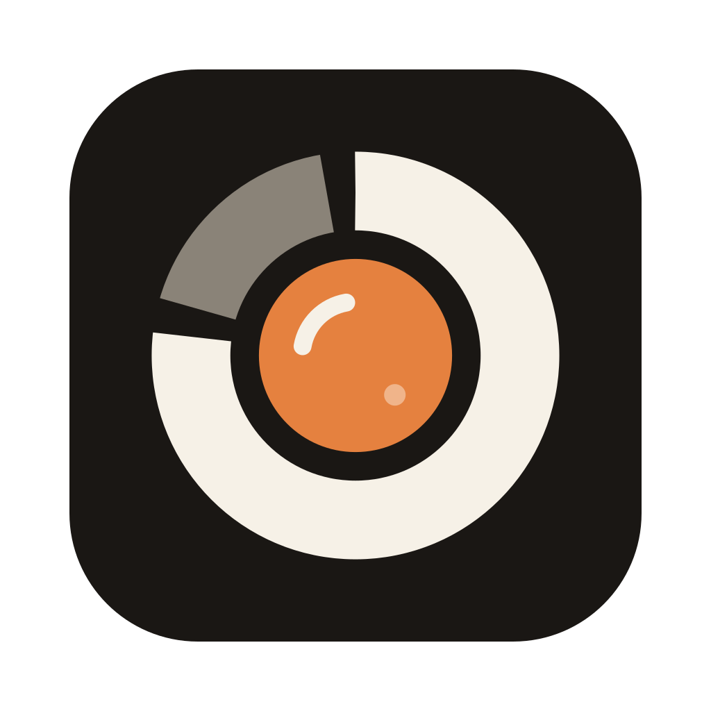
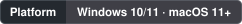
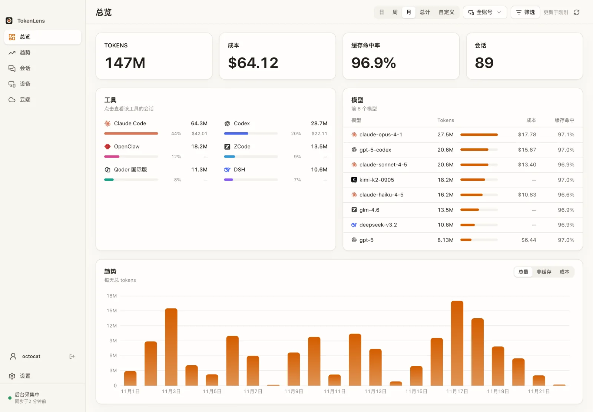
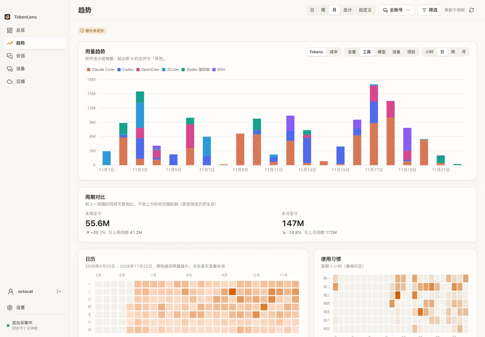
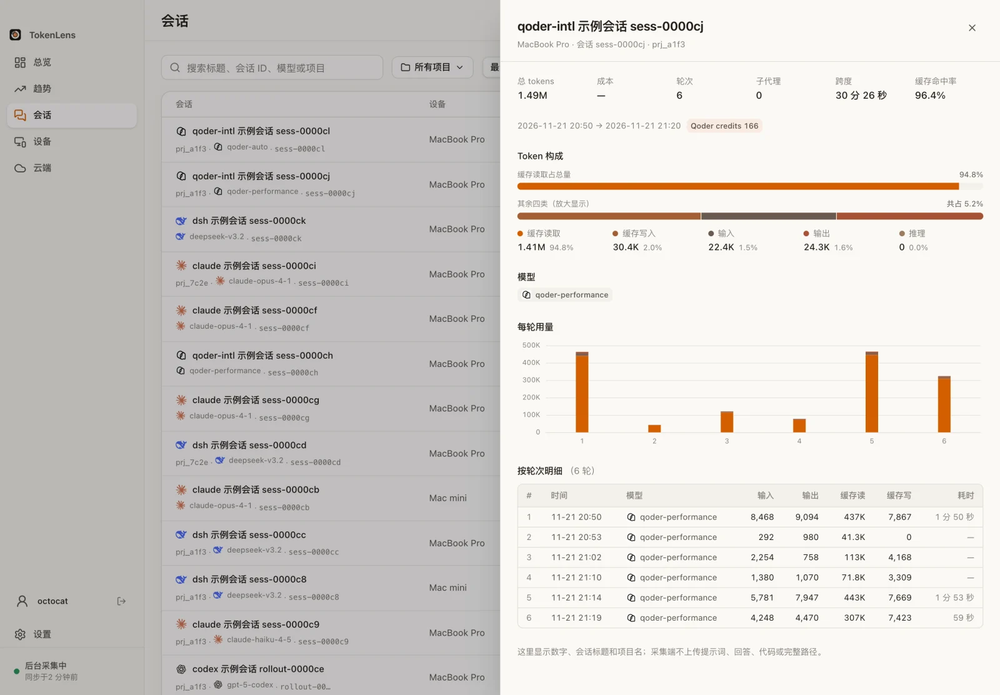
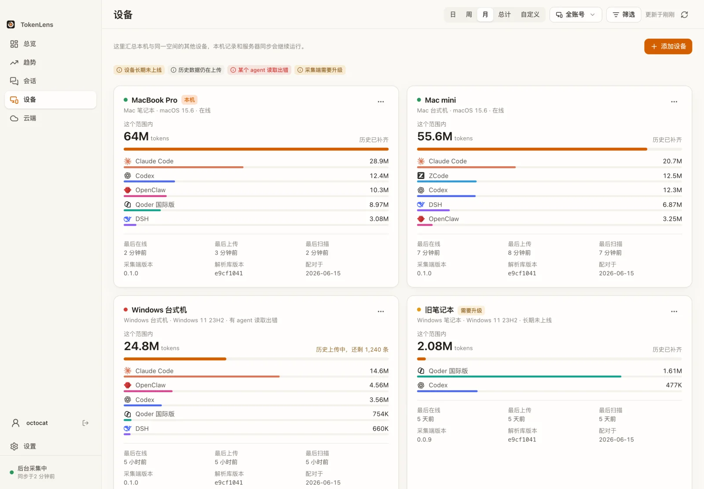
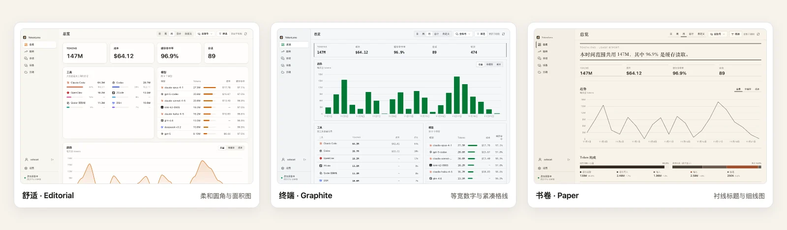
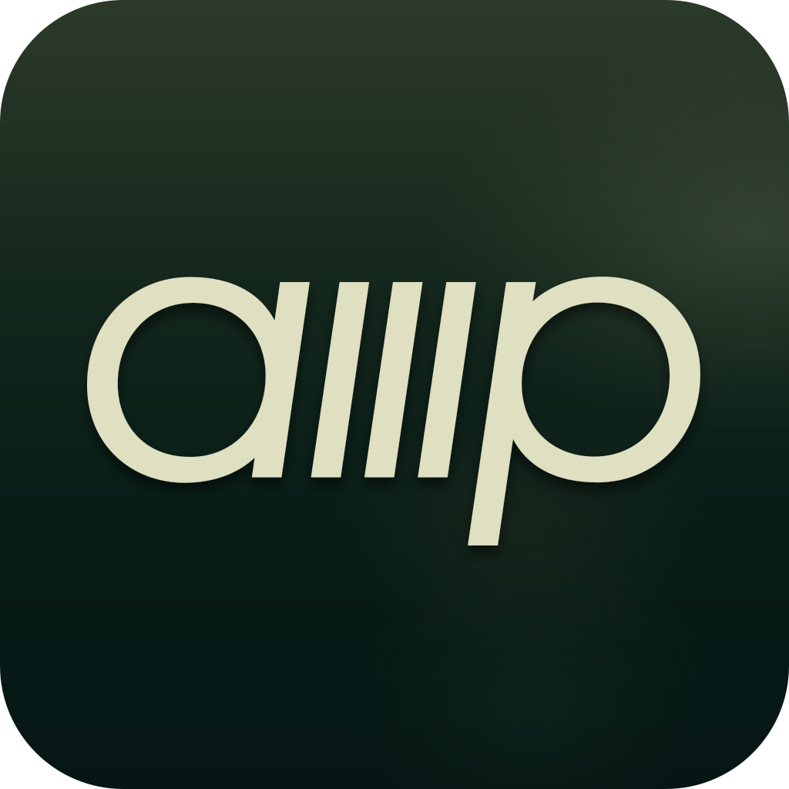

<div align="center">
  
  <h1>TokenLens</h1>
  <p><strong>See where your AI coding tokens actually go — across agents, models, sessions, and computers.</strong></p>
  <p>
    <a href="https://tokenlens.online/"></a>
    <a href="https://github.com/Dawn-4ever1/TokenLens/releases/latest"></a>
    <a href="#download"></a>
    <a href="#privacy"></a>
    <a href="LICENSE"></a>
  </p>
  <p>
    <strong>English</strong> · <a href="README.zh-CN.md">简体中文</a>
    &nbsp;&nbsp;|&nbsp;&nbsp;
    <a href="#highlights">Highlights</a> · <a href="#download">Download</a> · <a href="#supported-agents">Supported Agents</a> · <a href="#two-ways-to-use-it">Local &amp; Cloud</a> · <a href="#privacy">Privacy</a> · <a href="#build-from-source">Build</a>
  </p>
  <picture>
    <source media="(prefers-color-scheme: dark)" srcset=".github/readme/overview-dark.webp">
    <source media="(prefers-color-scheme: light)" srcset=".github/readme/overview-light.webp">
    
  </picture>
  <p><sub>Synthetic demo data · Switches automatically with GitHub Light &amp; Dark theme · Early release (<code>0.x</code>, UI currently in Simplified Chinese)</sub></p>
</div>

---

## Highlights

- **Token anatomy, separated** — Input, output, cache read, cache write, and reasoning tokens are broken out apart, because cache reads often make up 90%+ of raw totals and are not what you pay for.
- **API-equivalent cost reference** — Estimated daily from the public LiteLLM, OpenRouter, and `models.dev` price catalogs. Clearly marked as a reference (*not your bill*: subscriptions, team plans, and relays can differ substantially; Qoder preserves original credits).
- **Light in the background** — A native Tauri 2 tray app on Windows and macOS that reads agent logs only when files change and destroys its WebView on close. On macOS, it can optionally show today's abbreviated total in the menu bar.
- **Verified in-app updates** — Checks GitHub first and falls back to the verified release mirror on `tokenlens.online` (auto-check can be turned off in Settings). Downloads and installs a Minisign-verified update only when you choose.

<table>
  <tr>
    <td width="50%" valign="top">
      <picture>
        <source media="(prefers-color-scheme: dark)" srcset=".github/readme/trends-dark.webp">
        <source media="(prefers-color-scheme: light)" srcset=".github/readme/trends-light.webp">
        
      </picture>
      <p><strong>Trends &amp; Activity Heatmap</strong><br>Hourly, daily, weekly, and monthly stacked usage by tool, model, device, or project — paired with week-over-week comparisons, calendar views, and a weekday × hour rhythm heatmap.</p>
    </td>
    <td width="50%" valign="top">
      <picture>
        <source media="(prefers-color-scheme: dark)" srcset=".github/readme/session-detail-dark.webp">
        <source media="(prefers-color-scheme: light)" srcset=".github/readme/session-detail-light.webp">
        
      </picture>
      <p><strong>Session &amp; Per-Turn Drill-Down</strong><br>Search sessions by saved title, ID, model, or project. Inspect session cost summaries alongside every turn's token split and latency, with subagent streams rolled cleanly into their parent session.</p>
    </td>
  </tr>
  <tr>
    <td width="50%" valign="top">
      <picture>
        <source media="(prefers-color-scheme: dark)" srcset=".github/readme/devices-dark.webp">
        <source media="(prefers-color-scheme: light)" srcset=".github/readme/devices-light.webp">
        
      </picture>
      <p><strong>Multi-Computer Sync &amp; Coverage</strong><br>Track desktops and laptops side by side, check collector version, scan freshness, and upload backlog, and spot which agents have logs on each machine.</p>
    </td>
    <td width="50%" valign="top">
      <p><strong>Built for Daily Checking</strong></p>
      <ul>
        <li><strong>Instant scope switching</strong> — Toggle between <em>All Account</em>, <em>This Computer</em>, or any individual machine right from the header.</li>
        <li><strong>Cross-filter &amp; drill down</strong> — Filter by date range, agent, model, or project; click any agent row or calendar day to jump straight into matching sessions.</li>
        <li><strong>Click any number for exact digits</strong> — Toggle between compact abbreviations (<code>147M</code>) and full exact counts anywhere on screen.</li>
        <li><strong>Offline-resilient queue</strong> — Local SQLite storage and an independent outbox ensure zero missed events while offline, with automatic backfill when connected.</li>
      </ul>
    </td>
  </tr>
  <tr>
    <td colspan="2" valign="top">
      <picture>
        <source media="(prefers-color-scheme: dark)" srcset=".github/readme/styles-dark.webp">
        <source media="(prefers-color-scheme: light)" srcset=".github/readme/styles-light.webp">
        
      </picture>
      <p><strong>Three Visual Styles, Light &amp; Dark</strong> — Switch anytime between <strong>Editorial</strong> (comfortable rounded cards &amp; area charts), <strong>Graphite</strong> (monospace numerals &amp; compact grid), and <strong>Paper</strong> (serif headings &amp; hairline charts). Numbers and workflows stay identical.</p>
    </td>
  </tr>
</table>

---

## Download

Get the recommended installer from the [TokenLens Website](https://tokenlens.online/), or browse all versions on [GitHub Releases](https://github.com/Dawn-4ever1/TokenLens/releases):

| System | Installer | Notes |
|---|---|---|
| **Windows 10 / 11** (`x64`) | `TokenLens_<version>_x64-setup.exe` | NSIS installer (current-user install) |
| **macOS 11+** (`Apple silicon`) | `TokenLens_<version>_aarch64.dmg` | Intel Macs are not pre-packaged; [build from source](#build-from-source) |

<details>
<summary><strong>First launch: seeing "Windows protected your PC" or macOS "cannot be verified"? (Click to expand)</strong></summary>

The desktop installers are not commercially code-signed yet, so your OS will ask once on first launch:

- **Windows**: On *"Windows protected your PC"*, click **More info**, then **Run anyway**.
- **macOS**: Drag **TokenLens** into **Applications** and open it from there. If macOS says the developer cannot be verified, open **System Settings → Privacy & Security** and click **Open Anyway**. If macOS reports the app as damaged, run this once in Terminal:

  ```sh
  xattr -cr /Applications/TokenLens.app
  ```

</details>

---

## Supported Agents

TokenLens automatically discovers supported AI coding agents on your machine with zero per-tool configuration.

<table>
  <tr>
    <td align="center" width="160"><br><sub><strong>Claude Code</strong></sub></td>
    <td align="center" width="160"><picture><source media="(prefers-color-scheme: dark)" srcset=".github/readme/brands/openai-dark.svg"><source media="(prefers-color-scheme: light)" srcset=".github/readme/brands/openai-light.svg"></picture><br><sub><strong>Codex</strong></sub></td>
    <td align="center" width="160"><br><sub><strong>Qoder</strong></sub></td>
    <td align="center" width="160"><br><sub><strong>Gemini CLI</strong></sub></td>
    <td align="center" width="160"><br><sub><strong>OpenCode</strong></sub></td>
    <td align="center" width="160"><br><sub><strong>Kimi</strong></sub></td>
  </tr>
  <tr>
    <td align="center" width="160"><br><sub><strong>Qwen Code</strong></sub></td>
    <td align="center" width="160"><br><sub><strong>OpenClaw</strong></sub></td>
    <td align="center" width="160"><br><sub><strong>DSH</strong></sub></td>
    <td align="center" width="160"><br><sub><strong>ZCode</strong></sub></td>
    <td align="center" width="160"><br><sub><strong>WorkBuddy</strong></sub></td>
    <td align="center" width="160"><br><sub><strong>Antigravity</strong></sub></td>
  </tr>
  <tr>
    <td align="center" width="160"><br><sub><strong>Cline</strong></sub></td>
    <td align="center" width="160"><br><sub><strong>Roo Code</strong></sub></td>
    <td align="center" width="160"><br><sub><strong>Kilo Code</strong></sub></td>
    <td align="center" width="160"><br><sub><strong>Amp</strong></sub></td>
    <td align="center" width="160"><br><sub><strong>Droid</strong></sub></td>
    <td align="center" width="160"><picture><source media="(prefers-color-scheme: dark)" srcset=".github/readme/brands/copilot-dark.svg"><source media="(prefers-color-scheme: light)" srcset=".github/readme/brands/copilot-light.svg"></picture><br><sub><strong>Copilot</strong></sub></td>
  </tr>
</table>

<details>
<summary><strong>All supported tools &amp; how Qoder tokens / credits are handled (Click to expand)</strong></summary>

- **Additional auto-discovered tools** (via [tokscale](https://github.com/junhoyeo/tokscale) at a pinned revision): **Trae**, **Kiro**, **Augment**, **CodeBuddy**, **Zed**, **Warp**, **Goose**, **Junie**, **Crush**, **Grok CLI**, **Devin CLI / Desktop**, **Kilo CLI**, **LM Studio**, **Cherry Studio**, **Codebuff**, **Hermes**, **Pi**, and other compatible clients.
- **Qoder International &amp; Qoder CN (IDE, Desktop, and CLI)**: TokenLens uses its own Qoder adapter rather than upstream's Qoder parser. Recorded IDE token counts are read directly; credits-only sessions are converted via calibrated rates (`qoder-intl`) while keeping the original credits intact (`qoder-cn` keeps credits without fabricating tokens). Legacy bridge copies in `~/.qoder-cn/projects` are skipped by session fingerprint so usage is never double-counted.

</details>

---

## Two Ways to Use It

<table>
  <tr>
    <td width="50%" valign="top">
      <p><strong>1. On This Computer (Default)</strong></p>
      <ul>
        <li>Opens directly onto your local dashboard — <strong>no server or account required</strong>.</li>
        <li>Runs the exact same sync server code in-process on local SQLite.</li>
        <li>Local collection keeps working offline and refreshes public price catalogs daily.</li>
      </ul>
    </td>
    <td width="50%" valign="top">
      <p><strong>2. Across Several Computers</strong></p>
      <ul>
        <li>Open the Cloud page and connect <a href="https://tokenlens.online">https://tokenlens.online</a> for free using GitHub, Google, or an email code — sign in with the same account on each Mac or Windows PC.</li>
        <li>Signing out returns this computer to its local dashboard without deleting cloud devices or history.</li>
        <li>Or host your own server via <a href="deploy/README.md">deploy/README.md</a> and connect with a one-time pairing code. Local history is preserved and backfilled automatically.</li>
      </ul>
    </td>
  </tr>
</table>

---

## Privacy

- **Numbers and labels only** — Only statistical fields leave your agent logs: token counts, agent and model names, timestamps, session IDs, tool-saved session titles, project folder name, and a one-way hash of the workspace. **Prompts, answers, code, file contents, and full file paths are never stored in the database or uploaded.**
- **OS-keychain credentials** — Device ingest/read tokens and account sessions live in the macOS Keychain or Windows Credential Manager, never reach the WebView, and are stored on the server as hashes only.
- **Local stays local** — In local mode, zero usage data is uploaded. Read the full [Privacy Policy](https://tokenlens.online/privacy).
- **Anonymous update checks** — When enabled, checks run via anonymous GET requests ~10 seconds after launch and every 24 hours (GitHub first, verified release copy on `tokenlens.online` fallback) with no usage data or credentials sent. Updates are Minisign-verified before installation and can be turned off in Settings.

---

## Build from Source

Prerequisites: **Rust** (stable), **Node.js 24**, and the [Tauri 2 prerequisites](https://v2.tauri.app/start/prerequisites/) for your OS.

<details>
<summary><strong>Commands, test suite &amp; repository layout (Click to expand)</strong></summary>

Build and run the desktop app:

```sh
cd app
npm ci
npm run tauri dev        # desktop app with hot reload
npm run tauri build      # build an installer for this system
```

Run the test suites:

```sh
cargo test --workspace   # collector, server, and app shell
cd app && npm test       # frontend unit tests (Vitest)
npm run test:e2e         # UI tests in Chrome (Playwright, synthetic mock data)
```

| Path | What it is |
|---|---|
| `app/` | Tauri 2 desktop app: React + TypeScript UI in `src/`, Rust shell in `src-tauri/` |
| `crates/collector-core/` | Reads agent logs (`tokscale` + Qoder adapter), queues and uploads usage events |
| `crates/usage-event/` | Shared usage event schema and validation (`schema/usage-event.v1.json`) |
| `collector/` | Command-line collector for testing and headless machines |
| `server/` | Sync server (`axum` + SQLite WAL): pairing, ingest, dashboard API, pricing, public site |
| `deploy/` | Docker Compose, Caddy, backup, and restore scripts for self-hosting |
| `scripts/` | Release, packaging, and privacy verification scripts; `reconcile/` compares with a legacy Hub |

> Code comments occasionally reference design notes such as `D0xx`; those internal design logs are not part of this public repository.

</details>

---

## Credits

- [tokscale](https://github.com/junhoyeo/tokscale) (`MIT`) — parses agent logs and provides catalog-based pricing.
- [TokenTracker](https://github.com/xiufengsun/TokenTracker) (`MIT`) — inspiration for the warm colour system.
- Agent and vendor marks belong to their respective owners and are used solely to identify each tool; see [THIRD_PARTY_NOTICES.md](THIRD_PARTY_NOTICES.md).

## License

[MIT](LICENSE)
