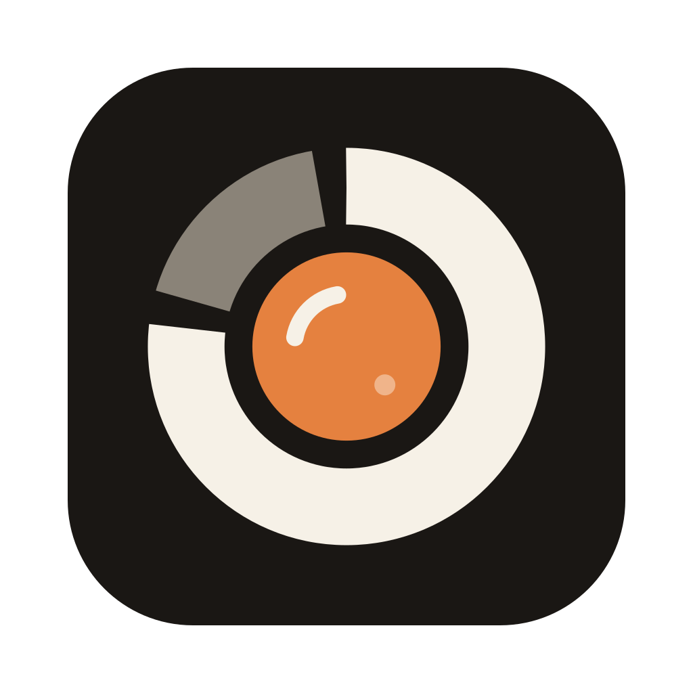
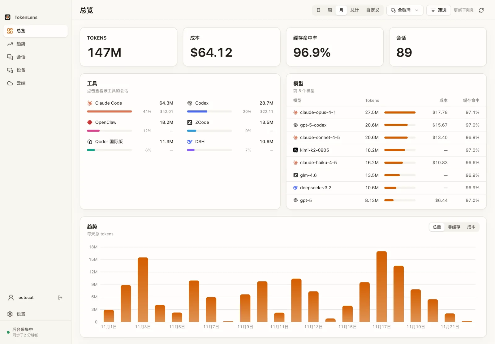
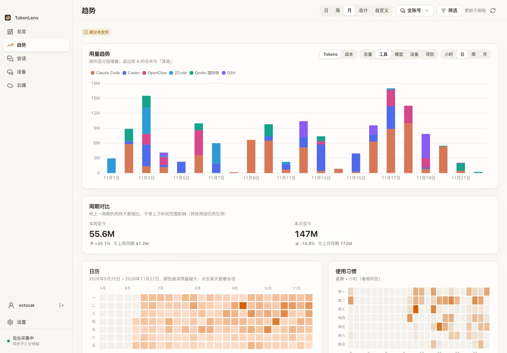
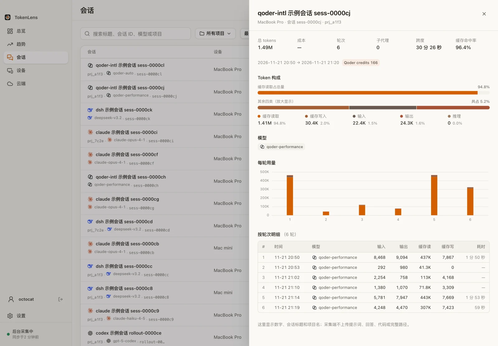
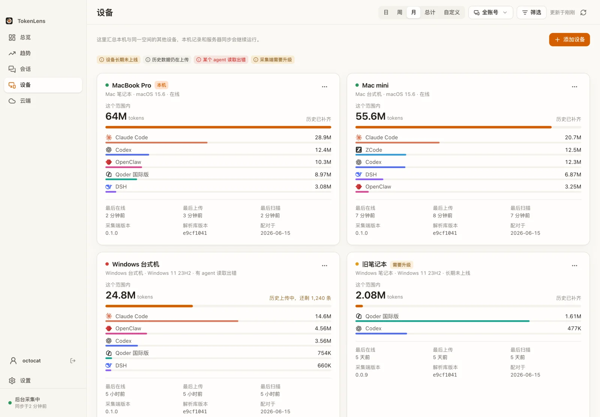
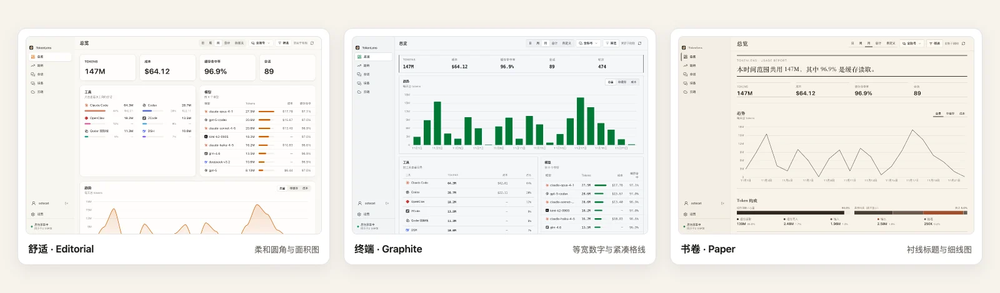
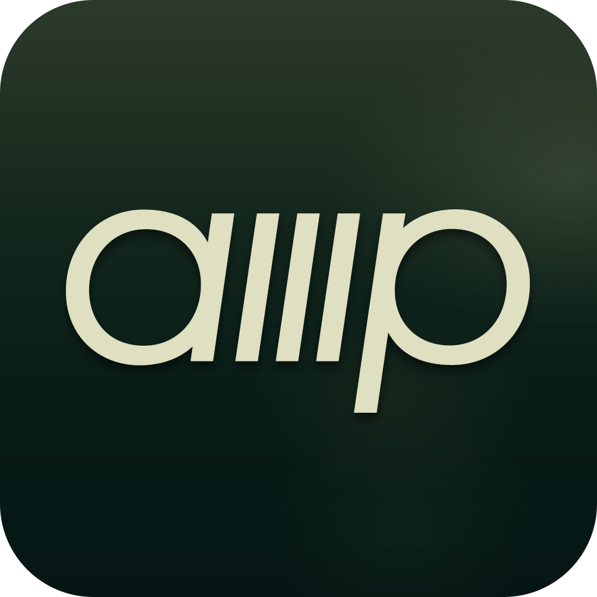

<div align="center">
  
  <h1>TokenLens</h1>
  <p><strong>看清每一次 AI 编程的 Token 究竟花在哪里——跨工具、跨模型、跨会话、跨电脑。</strong></p>
  <p>
    <a href="https://tokenlens.online/"></a>
    <a href="https://github.com/Dawn-4ever1/TokenLens/releases/latest"></a>
    <a href="#下载"></a>
    <a href="#隐私"></a>
    <a href="LICENSE"></a>
  </p>
  <p>
    <a href="README.md">English</a> · <strong>简体中文</strong>
    &nbsp;&nbsp;|&nbsp;&nbsp;
    <a href="#界面与亮点">界面与亮点</a> · <a href="#下载">立即下载</a> · <a href="#支持的工具">支持工具</a> · <a href="#两种用法">本机与云端</a> · <a href="#隐私">隐私边界</a> · <a href="#从源码构建">源码构建</a>
  </p>
  <picture>
    <source media="(prefers-color-scheme: dark)" srcset=".github/readme/overview-dark.webp">
    <source media="(prefers-color-scheme: light)" srcset=".github/readme/overview-light.webp">
    
  </picture>
  <p><sub>虚构演示数据 · 随 GitHub 浅色/深色模式自动切图 · 早期版本（<code>0.x</code>，应用界面目前为简体中文）</sub></p>
</div>

---

## 界面与亮点

- **看清 Token 花在哪** — 输入、输出、缓存读取、缓存写入、推理分开计算；缓存读取通常占九成以上，不直接等于实际扣费。
- **API 等价成本估算** — 按 LiteLLM、OpenRouter、models.dev 三份公开价格表每天刷新估算（明确标注非实际账单：订阅制与中转站价格可能相差很大；Qoder 保留原始 credits）。
- **订阅额度一眼可见** — 左侧「额度」页显示 Codex、Claude Code 自己记在这台电脑上的 5 小时与本周额度、重置倒计时，用到 80% 变色提醒；只在本机按需读取，不联网、不读取登录信息、不上传。
- **轻量后台常驻** — 基于 Tauri 2 的 Windows / macOS 托盘应用，仅在本地日志变化时读取，关闭窗口即释放界面内存；Mac 端可选在顶部状态栏显示今日总用量简写。
- **应用内验签更新** — 优先检查 GitHub 正式版本，失败时回退至 `tokenlens.online` 已验证发布镜像（可在设置里关闭自动检查）；点「下载并更新」后才下载、验签并安装。

<table>
  <tr>
    <td width="50%" valign="top">
      <picture>
        <source media="(prefers-color-scheme: dark)" srcset=".github/readme/trends-dark.webp">
        <source media="(prefers-color-scheme: light)" srcset=".github/readme/trends-light.webp">
        
      </picture>
      <p><strong>趋势与习惯热力图</strong><br>支持小时、日、周、月粒度及按工具、模型、设备、项目堆叠展示，搭配本周/本月周期对比、日历热力与「星期 × 小时」习惯热力图。</p>
    </td>
    <td width="50%" valign="top">
      <picture>
        <source media="(prefers-color-scheme: dark)" srcset=".github/readme/session-detail-dark.webp">
        <source media="(prefers-color-scheme: light)" srcset=".github/readme/session-detail-light.webp">
        
      </picture>
      <p><strong>会话与逐轮拆解</strong><br>按工具已保存标题、会话 ID、模型或项目搜索，展开即可查看会话成本汇总以及每一轮的 Token 构成与耗时；子代理用量自动归入父会话。</p>
    </td>
  </tr>
  <tr>
    <td width="50%" valign="top">
      <picture>
        <source media="(prefers-color-scheme: dark)" srcset=".github/readme/devices-dark.webp">
        <source media="(prefers-color-scheme: light)" srcset=".github/readme/devices-light.webp">
        
      </picture>
      <p><strong>多设备汇总与状态总览</strong><br>并排查看台式机与笔记本用量、采集端版本、扫描与同步新鲜度，并用覆盖矩阵一眼发现哪台电脑少了哪部分工具记录。</p>
    </td>
    <td width="50%" valign="top">
      <p><strong>顺手的日常查看体验</strong></p>
      <ul>
        <li><strong>设备范围一键切换</strong> — 顶部直接选择「全账号」「本机」或单独某一台电脑。</li>
        <li><strong>下钻与联动筛选</strong> — 按日期、设备、工具、模型、项目任意组合筛选；点击工具或日历某一天直接跳入对应会话。</li>
        <li><strong>点击数字切换精确值</strong> — 在任意页面点击 Token 数字，即可在简写（<code>147M</code>）与完整数字之间切换。</li>
        <li><strong>断网不丢记录</strong> — 本机 SQLite 搭配独立发送队列，离线照常采集，恢复联网后自动补传。</li>
      </ul>
    </td>
  </tr>
  <tr>
    <td colspan="2" valign="top">
      <picture>
        <source media="(prefers-color-scheme: dark)" srcset=".github/readme/styles-dark.webp">
        <source media="(prefers-color-scheme: light)" srcset=".github/readme/styles-light.webp">
        
      </picture>
      <p><strong>三种视觉风格 · 均支持浅色与深色模式</strong> — 随时在<strong>舒适（Editorial）</strong>、<strong>终端（Graphite）</strong>与<strong>书卷（Paper）</strong>之间切换，字体、卡片密度与图表形态各有侧重，统计口径与交互方式完全一致。</p>
    </td>
  </tr>
</table>

---

## 下载

前往 [TokenLens 官网](https://tokenlens.online/)（自动识别系统并推荐对应安装包），或在 [GitHub Releases](https://github.com/Dawn-4ever1/TokenLens/releases) 查看历史版本：

| 系统 | 安装包文件名 | 说明 |
|---|---|---|
| **Windows 10 / 11**（64 位） | `TokenLens_<版本>_x64-setup.exe` | NSIS 安装包（当前用户安装） |
| **macOS 11 及以上**（Apple 芯片） | `TokenLens_<版本>_aarch64.dmg` | Intel Mac 暂未提供预打包，请参考 [从源码构建](#从源码构建) |

<details>
<summary><strong>首次打开遇到系统安全提示怎么办？（点击查看 Windows / macOS 打开步骤）</strong></summary>

安装包暂时没有购买系统商业代码签名，第一次打开时系统会弹窗提示：

- **Windows**：出现「Windows 已保护你的电脑」时，点 **更多信息**，再点 **仍要运行**。
- **macOS**：拖入「应用程序」后打开；若提示「无法验证开发者」，请打开 **系统设置 → 隐私与安全性** 点击 **仍要打开**。若系统提示「已损坏」，在终端执行一次以下命令即可正常打开：

  ```sh
  xattr -cr /Applications/TokenLens.app
  ```

</details>

---

## 支持的工具

自动发现本机受支持的 AI 编程助手日志，无需逐个手动配置路径。

<table>
  <tr>
    <td align="center" width="160"><br><sub><strong>Claude Code</strong></sub></td>
    <td align="center" width="160"><picture><source media="(prefers-color-scheme: dark)" srcset=".github/readme/brands/openai-dark.svg"><source media="(prefers-color-scheme: light)" srcset=".github/readme/brands/openai-light.svg"></picture><br><sub><strong>Codex</strong></sub></td>
    <td align="center" width="160"><br><sub><strong>Qoder</strong></sub></td>
    <td align="center" width="160"><br><sub><strong>Gemini CLI</strong></sub></td>
    <td align="center" width="160"><br><sub><strong>OpenCode</strong></sub></td>
    <td align="center" width="160"><br><sub><strong>Kimi</strong></sub></td>
  </tr>
  <tr>
    <td align="center" width="160"><br><sub><strong>Qwen Code</strong></sub></td>
    <td align="center" width="160"><br><sub><strong>OpenClaw</strong></sub></td>
    <td align="center" width="160"><br><sub><strong>DSH</strong></sub></td>
    <td align="center" width="160"><br><sub><strong>ZCode</strong></sub></td>
    <td align="center" width="160"><br><sub><strong>WorkBuddy</strong></sub></td>
    <td align="center" width="160"><br><sub><strong>Antigravity</strong></sub></td>
  </tr>
  <tr>
    <td align="center" width="160"><br><sub><strong>Cline</strong></sub></td>
    <td align="center" width="160"><br><sub><strong>Roo Code</strong></sub></td>
    <td align="center" width="160"><br><sub><strong>Kilo Code</strong></sub></td>
    <td align="center" width="160"><br><sub><strong>Amp</strong></sub></td>
    <td align="center" width="160"><br><sub><strong>Droid</strong></sub></td>
    <td align="center" width="160"><picture><source media="(prefers-color-scheme: dark)" srcset=".github/readme/brands/copilot-dark.svg"><source media="(prefers-color-scheme: light)" srcset=".github/readme/brands/copilot-light.svg"></picture><br><sub><strong>Copilot</strong></sub></td>
  </tr>
</table>

<details>
<summary><strong>查看全部支持工具与 Qoder 统计口径说明（点击展开）</strong></summary>

- **更多自动发现的工具**（基于锁版本的 [tokscale](https://github.com/junhoyeo/tokscale) 解析库）：**Trae**、**Kiro**、**Augment**、**CodeBuddy**、**Zed**、**Warp**、**Goose**、**Junie**、**Crush**、**Grok CLI**、**Devin CLI / 桌面端**、**Kilo CLI**、**LM Studio**、**Cherry Studio**、**Codebuff**、**Hermes**、**Pi** 等。
- **Qoder 国际版与 Qoder CN（含 IDE、桌面端与 CLI）**：独立适配，不走上游 Qoder 解析路径。IDE 中已记录的真实 Token 直接读取；仅含 credits 的旧会话在保留原始 credits 的同时，按校准汇率折算（`qoder-intl`）或仅记 credits 不伪造 Token（`qoder-cn`）；自动按会话指纹跳过历史桥接副本，避免重复计算。

</details>

---

## 两种用法

<table>
  <tr>
    <td width="50%" valign="top">
      <p><strong>1. 只在这台电脑上用（默认）</strong></p>
      <ul>
        <li>安装后打开直接查看本机用量，<strong>无需注册账号或搭建服务器</strong>。</li>
        <li>应用内嵌同一套服务端逻辑，数据保存在本机 SQLite 数据库中。</li>
        <li>断网仍可持续采集，联网时每日刷新公开价格目录。</li>
      </ul>
    </td>
    <td width="50%" valign="top">
      <p><strong>2. 多台电脑合并查看</strong></p>
      <ul>
        <li>在「云端」页免费连接 <a href="https://tokenlens.online">TokenLens 云服务</a>，支持 GitHub、Google 或邮箱验证码登录；每台电脑登录同一账号即可自动归入同一空间。</li>
        <li>退出账号后本机立即回到本机看板，云端设备与历史不会删除。</li>
        <li>也可按 <a href="deploy/README.md">deploy/README.md</a>（英文）自建服务器并通过一次性配对码连接；历史记录会自动保留并补传。</li>
      </ul>
    </td>
  </tr>
</table>

---

## 隐私

- **只取数字与必要统计标签** — 仅从 agent 日志读取 token 数、工具与模型名、时间、会话标识、工具已保存的会话标题，以及项目名称与工作区标识的单向哈希。**提示词、回答、代码、文件内容和完整文件路径绝不入库，也不会上传。**
- **凭据只存系统钥匙串** — 连接服务器的上传/读取凭据保存在 macOS 钥匙串或 Windows 凭据管理器中，网页视图 JS 拿不到；服务端仅保存哈希。
- **本机模式零上传** — 处于「只在这台电脑上」模式时，不会向服务器上传任何用量记录。完整数据边界见 [隐私政策](https://tokenlens.online/privacy)。
- **匿名更新检查** — 开启自动检查后，启动约 10 秒及每 24 小时匿名读取公开版本信息（GitHub 优先，失败回退官网验证副本），不携带任何用量或凭据；安装前强制验证 Minisign 签名，也可在设置里随时关闭。

---

## 从源码构建

编译环境需要 **Rust**（stable）、**Node.js 24**，以及对应系统的 [Tauri 2 构建依赖](https://v2.tauri.app/start/prerequisites/)。

<details>
<summary><strong>展开开发命令、测试与目录结构说明</strong></summary>

开发与打包：

```sh
cd app
npm ci
npm run tauri dev        # 启动带热重载的桌面开发版
npm run tauri build      # 打当前系统的正式安装包
```

运行测试：

```sh
cargo test --workspace   # 采集端、服务端与应用外壳
cd app && npm test       # 前端单元测试（Vitest）
npm run test:e2e         # Chrome 界面自动化测试（Playwright，使用内置模拟数据）
```

| 目录 | 用途 |
|---|---|
| `app/` | Tauri 2 桌面应用：`src/` 为 React + TypeScript 界面，`src-tauri/` 为 Rust 外壳 |
| `crates/collector-core/` | 日志解析（`tokscale` + Qoder adapter）、本地发送队列与上传核心 |
| `crates/usage-event/` | 各端共用的事件结构与白名单校验（`schema/usage-event.v1.json`） |
| `collector/` | 命令行采集器，用于无界面机器与本地测试 |
| `server/` | 同步服务端（`axum` + SQLite WAL）：配对、入库、看板 API、定价与官网 |
| `deploy/` | 自建部署用的 Docker Compose、Caddy、备份与恢复脚本 |
| `scripts/` | 发版、打包与隐私扫描脚本；`reconcile/` 为历史基线对账工具 |

> 代码注释里的 `D0xx` 指内部设计决策编号，相关记录不包含在本公开仓库内。

</details>

---

## 致谢

- [tokscale](https://github.com/junhoyeo/tokscale)（`MIT`）— 解析本地 agent 日志与模型定价参考。
- [TokenTracker](https://github.com/xiufengsun/TokenTracker)（`MIT`）— 界面配色思路参考。
- 各 agent 与模型厂商标志归各自版权所有者所有，仅用于区分工具来源，详见 [THIRD_PARTY_NOTICES.md](THIRD_PARTY_NOTICES.md)。

## 许可

[MIT](LICENSE)
